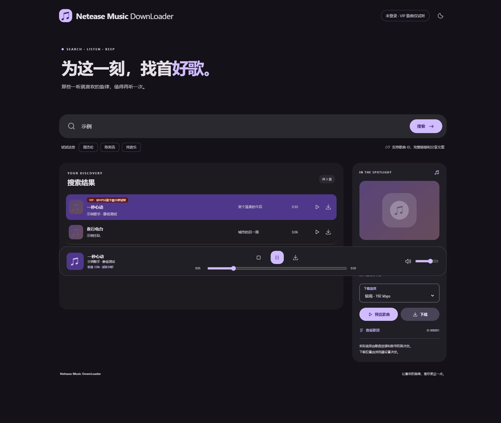

# Netease DownLoader — 网易云音乐本地解析 CLI

本地跑在终端里的网易云解析工具：搜索、歌曲详情、播放直链、歌词、歌单、专辑、歌手、榜单，登录（扫码 / 手机号 / 短信码 / 浏览器 Cookie），以及下载。
提供终端版和 Material Design 3 风格网页版，支持歌曲预览、下载音质选择、VIP / 试听提示。
**零第三方依赖**，只用 Node 内置的 `crypto`、`fetch`、`node:sqlite` 直连网易云 `weapi` / `eapi` 接口；二维码渲染是可选依赖 `qrcode-terminal`。

```
$ nj search 晴天
$ nj url 2652820720 --level lossless
$ nj download --playlist 3778678 -o ./music
```

## 环境

- Node.js >= 18（本项目在 Node 22 上验证）
- `nj login --browser` 需要 Node >= 22.5（用到内置 `node:sqlite`）；只用扫码 / 手机号 / `--cookie` 时 18 就够

## 网页版

Windows 双击 **`start-web.bat`** 启动 `Netease Music DownLoader`，自动打开浏览器。终端版使用独立的 **`start-cli.bat`**。

```bash
npm run web
node bin/nj-web.js --port 8787  # 指定端口，默认自动选空闲端口
node bin/nj-web.js --no-open    # 手动访问启动窗口打印的地址
```

- MD3 风格，支持明暗主题、页面入场、列表切换、按钮涟漪和播放器展开动画；遵循系统“减少动态效果”偏好。
- 输入歌名 / 歌手搜索，或输入歌曲 ID、歌曲 URL、短链、分享文案直接打开歌曲。
- 页内预览默认标准音质，底部播放器支持暂停、进度拖动、音量和停止。
- 下载前选择标准、较高、极高或无损音质；实际音质由资源和账号权限决定。下载位置由浏览器设置决定。
- VIP 歌曲名前显示“非VIP只能下载30秒试听”；会员下载和单独付费歌曲分别标识。试听文件名带实际片段长度，例如 `(试听30秒)`。没有可用地址时提示原因。
- 网页版和 CLI 共用 `~/.netease-cli.json` 登录态，可先用 `nj login` 登录；Cookie 不会发送到网页前端。
- 服务只监听本机 `127.0.0.1`，在启动窗口按 `Ctrl+C` 停止；关闭标签页不会停止整个网页服务。

## 自检

```bash
node test/smoke.js            # 加密 / eapi / cookie 解析 / 链接解析 / 格式化
node test/download.js         # 本地 HTTP 服务验证下载落盘与去重
node test/playback.js         # ID/链接输入、VIP 标识、音质选择、预览与交互流程
node test/web.js              # 网页搜索分页、播放、试听下载、歌词与会话校验
node test/browser-cookie.js   # DPAPI + AES-GCM 全链路（会造一个假 Chromium profile）
node test/integration-login.js# 跑完整的 nj login --browser 集成链路
```

`npm test` 运行前四组离线测试。浏览器测试使用模拟 Cookie 数据库，不会读取真实浏览器 Cookie。
`test/integration-login.js` 会访问实际服务并暂时写入当前用户配置，日常检查优先运行 `npm test`。

## 安装 / 运行

```bash
# 方式一：直接跑
node bin/nj.js search 晴天

# 方式二：Windows 双击/命令行用批处理
start-cli.bat search 晴天

# 方式三：全局注册 nj 命令
npm link
nj search 晴天
```

也可以把 `netease-cli` 目录加到 PATH，或者在 `package.json` 所在目录用 `npm start -- search 晴天`。
首次安装可运行 `npm install`，用于安装可选的终端二维码渲染依赖；搜索、网页、预览和下载本身使用 Node.js 内置模块。

### 网页界面



## 交互模式

直接运行 `nj`（不带参数）进入交互 shell：

```
♫ 网易云音乐 · 本地交互模式
♫ 搜索/命令 > 晴天
```

| 操作 | 说明 |
| --- | --- |
| 直接输入关键词 | 按当前类型搜索 |
| `↑` / `↓`（或 `k` / `j`） | 移动高亮 |
| `Enter` | 打开：歌曲详情 / 歌单 / 专辑 / 歌手 |
| `u` / `l` / `d` | 对选中项取直链 / 看歌词 / 下载 |
| `p` / `s` | 预览选中歌曲 / 停止预览 |
| `D` | 下载当前列表里的全部歌曲 |
| `[` `]` 或 `←` `→` | 上一页 / 下一页 |
| `b` 或 `Esc` | 返回上一级 |
| `/` | 回到搜索 |
| `q` | 退出 |
| `/type song\|album\|artist\|playlist` | 切换搜索类型 |
| `/page N` | 跳到第 N 页 |
| `/level` / `/level lossless` | 打开音质菜单 / 设置默认下载音质 |
| `/stop` | 停止预览 |
| `/help` | 帮助 |

直接输入歌曲 ID、歌曲 URL 或分享文案可打开详情。歌曲详情页：`p` 预览、`s` 停止、`u` 直链、`l` 歌词、`d` 选择音质下载、`o` 浏览器打开、`b` 返回。单曲下载和 `D` 批量下载都会出现音质菜单，批量只选择一次。

非 TTY 环境（管道/重定向）会自动退化为序号菜单：输入 `序号` 打开、`p 3` 预览第 3 首、`u 3` 取直链、`s` 停止预览、`D` 全部下载、`n/p` 翻页、`b` 返回、`q` 退出。

## 命令

### 搜索 / 解析

| 命令 | 说明 |
| --- | --- |
| `nj` / `nj ui` | 进入交互模式 |
| `nj search <关键词> [--type song\|album\|artist\|playlist] [--limit 20] [--offset 0]` | 搜索 |
| `nj parse <链接\|分享文本>` | 从 `music.163.com` 链接、`163cn.tv` 短链、App 分享文案里提取 ID 并直接取数据 |
| `nj toplist` | 列出所有官方榜单 |

### 取数据

| 命令 | 说明 |
| --- | --- |
| `nj song <ID...>` | 歌曲详情，支持逗号分隔多个 ID |
| `nj url <ID> [--level lossless]` | 播放直链、码率、大小、MD5（取不到自动降级并标注来源/降级信息） |
| `nj preview <ID\|歌曲URL\|分享文本> [--level standard]` | 浏览器播放器中预览，也可用 `nj play`；关闭页面或 `Ctrl+C` 停止 |
| `nj lyric <ID> [--trans]` | 歌词，`--trans` 显示翻译 |
| `nj playlist <ID> [--all] [--limit N]` | 歌单详情 + 歌曲列表 |
| `nj album <ID>` | 专辑详情 |
| `nj artist <ID> [--songs]` | 歌手信息 + 热门 50 首 |

### 下载

| 命令 | 说明 |
| --- | --- |
| `nj download <ID\|链接\|分享文本>` | 单曲下载 |
| `nj download <id1,id2,id3>` | 多首下载 |
| `nj download --playlist <歌单ID>` | 整张歌单批量下载 |
| `nj download --playlist <ID> --limit 10` | 只下前 10 首 |
| `-o <目录>` / `-d <目录>` | 输出目录，默认 `./downloads` |
| `--name "{artist} - {name}"` | 文件名模板，支持 `{name} {artist} {album} {id}` |
| `--level lossless` | 默认 `lossless`，取不到自动降级：`standard` 128k / `higher` 192k / `exhigh` 320k / `lossless` 无损 |

`song`、`url`、`lyric`、`preview` 和 `download` 均支持歌曲 ID、歌曲链接或分享文案，`song` 保留多数字 ID 输入。
在真实终端执行 `download` 且未传 `--level` 时可选择音质；管道模式默认无损，也可用 `--level` 指定。
试听下载会提前提示，并在文件名添加试听标记。CLI 预览时需保持进程运行。

### 登录（VIP 完整歌曲需要账号具备相应权限）

```bash
nj login                                   # 交互式选择登录方式（推荐新手）
nj login --browser chrome|edge|firefox|auto # 直接复用浏览器里已登录的网易云登录态（最快）
nj login --qr                              # 手机网易云 App 扫终端里的二维码
nj login --phone 13800138000 --password 你的密码
nj login --phone 13800138000 --send        # 先发短信验证码
nj login --phone 13800138000 --captcha 1234
nj login --email you@mail.com --password 你的密码
nj login --cookie "MUSIC_U=xxxx; __csrf=yyyy"
nj login --cookie-file cookie.txt
nj whoami      # 账号昵称 / uid / 是否黑胶 / 到期时间 / Cookie 是否有效
nj logout      # 清除本地登录态
nj config      # 配置文件位置与内容摘要
```

- 登录态（`MUSIC_U`、`__csrf` 等）保存在 `~/.netease-cli.json`，之后的 `nj url` / `nj download` 自动带上，**VIP 曲目就能拿到真实直链**。
- `--browser` 走本机浏览器 Cookie 库：Chromium 系用 DPAPI 解 `Local State` 的密钥再 AES-256-GCM 解 `encrypted_value`（需要 Node ≥ 22.5 的 `node:sqlite`）。
  **浏览器运行时会独占 Cookie 数据库**，请先完全退出浏览器；Chrome/Edge 127+ 的 `v20` App-Bound 加密无法离线解密，这种情况用 `--cookie` 手工粘贴。
- 二维码渲染用可选依赖 `qrcode-terminal`（`npm i qrcode-terminal`）；没装时会打印二维码内容链接。
- 手工取 Cookie：浏览器登录 <https://music.163.com> → F12 → Application/存储 → Cookies → 复制 `MUSIC_U`（带上 `__csrf` 更稳）。
- 接口返回 `-462 / -460` 是网易风控（要人机验证或判定网络环境异常），与账号密码对错无关：
  先试 `--browser`，或换手机热点 / 家用宽带，或直接用 `--cookie` 复用浏览器登录态。

### 全局参数

- `--json` 输出接口原始 JSON，方便管道处理
- `-h, --help` / `-v, --version`

## 示例

```bash
# 搜歌
nj search 稻香 --limit 5

# 取最高音质直链
nj url 185809 --level lossless

# 下载到指定目录
nj download 185809 -o D:\Music

# 从 App 分享文案直接下载
nj download "分享周杰伦的单曲《稻香》: https://163cn.tv/xxxxx"

# 整张专辑/榜单
nj playlist 3778678 --limit 10
nj download --playlist 3778678 --limit 10 -o ./hot

# 管道处理
nj search 周杰伦 --json | jq '.result.songs[0].id'
```

## 实现原理

1. **weapi 加密**（`src/crypto.js`）
   - 明文 `JSON.stringify(params)` → AES-128-CBC（key `0CoJUm6Qyw8W8jud`，iv `0102030405060708`）
   - 再用随机 16 位密钥 AES-128-CBC 加密一次，得到 `params`
   - 随机密钥反转后用 RSA（1024 位公钥、`RSA_NO_PADDING`、左补零到 128 字节）加密，转 hex 得到 `encSecKey`
   - POST `application/x-www-form-urlencoded` 到 `https://music.163.com/weapi/<path>`
2. **设备指纹**（`src/request.js`）
   - `_ntes_nuid` / `_ntes_nnid` / `WNMCID` / `deviceId` 首次生成后写入配置，之后复用，避免因每次指纹不同触发风控
   - 未登录时自动走 `/weapi/register/anonimous` 申请匿名 `MUSIC_A` token（`username = base64(deviceId + " " + base64(md5(xor(deviceId))))`）
3. **直链（eapi 优先）**
   - eapi（`src/eapi.js`）：AES-128-ECB，key `e82ckenh8dichen8`，明文 `nobody<url>use<json>md5forencrypt` 的 md5 做签名，
     拼成 `<url>-36cd479b6b5-<json>-36cd479b6b5-<digest>` 加密后 POST 到 `https://interface.music.163.com/eapi/...`
   - 取链顺序：eapi `/api/song/enhance/player/url/v1` → weapi `/song/enhance/player/url/v1` → weapi 旧接口 `br`
   - 每一层内部按 `lossless → exhigh → higher → standard` 自动降级，账号没权限就退到能拿到的最高音质
   - **会员直链只有 eapi + 有效 `MUSIC_U` 才稳**，这也是加 `--level lossless` 默认值的理由
4. **下载**：直链带 `Referer: https://music.163.com/` 请求，`stream` 管道写文件，TTY 下显示进度条

## 目录结构

```
netease-cli/
├─ bin/nj.js          CLI 入口
├─ bin/nj-web.js      网页版入口
├─ start-cli.bat      终端版启动器
├─ start-web.bat      网页版独立启动器
├─ LICENSE           MIT 许可证
├─ .github/workflows/test.yml  自动化测试
├─ web/               MD3 网页、样式与页面交互
├─ src/
│  ├─ crypto.js       weapi 加密（AES + RSA）
│  ├─ eapi.js         eapi 加密（AES-128-ECB，会员直链）
│  ├─ request.js      请求、Cookie/设备指纹、匿名 token、csrf
│  ├─ login.js        登录：扫码 / 手机号 / 短信码 / 邮箱 / Cookie / 账号校验
│  ├─ browsercookie.js 从本机浏览器读 MUSIC_U（DPAPI + AES-GCM）
│  ├─ api.js          各接口封装
│  ├─ parse.js        链接 / 分享文本 → ID
│  ├─ download.js     流式下载
│  ├─ audio.js        预览 / 网页下载音频转发（支持 Range）
│  ├─ music.js        音质菜单、权限与试听提示
│  ├─ preview.js      CLI 浏览器预览播放器
│  ├─ web.js          本机网页服务与接口
│  ├─ format.js       终端表格 / 颜色 / 时长格式化
│  ├─ config.js       ~/.netease-cli.json 读写
│  ├─ interactive.js  交互模式（方向键列表 / 详情页 / 搜索 / 登录）
│  └─ cli.js          命令实现
└─ test/smoke.js      加密 / 登录 cookie 解析 / 解析 / 格式 冒烟测试
```

## 常见问题

- **VIP 歌曲 download 直接跳过 / 返回「没有可用播放地址」**：没登录或登录的不是黑胶账号。`nj login --browser chrome`（或 `--qr` / `--cookie`）之后 `nj whoami` 确认会员状态，再 `nj download <ID>`。
- **登录返回 `-462 请完成验证操作` / `-460 检测到您的网络环境存在风险`**：网易风控，不是密码错。优先 `nj login --browser chrome` 复用浏览器登录态；或换手机热点再试扫码；或 `nj login --cookie "MUSIC_U=...; __csrf=..."`。
- **`--browser` 报 `EBUSY`**：浏览器正在独占 Cookie 数据库，完全退出 Chrome/Edge 后重试。
- **`--browser` 报 `v20 App-Bound 加密无法离线解密`**：Chrome/Edge 127+ 的新加密，浏览器里装个 Cookie 导出扩展，或 F12 手工复制Cookie字段。
- **返回「没有可用播放地址」**：VIP / 付费 / 版权下架歌曲在未登录时拿不到直链；登录后仍失败一般是账号非会员或该曲目只给试听片段（会提示 `⚠ 试听片段`）。
- **无损音质拿不到**：需要账号有黑胶会员，且该曲目有 flac 资源；取不到会自动降级并在 `nj url` 里标 `已从 无损 降级`。
- **短链 163cn.tv 解析失败**：短链需要能正常跟随重定向，网络不通时会退回失败。

## 开源许可证

本项目源代码采用 [MIT License](LICENSE)，版权署名为 `izkaurn`。分发代码时请保留版权和许可证声明。
源代码许可不包含音乐、歌词、专辑封面或平台商标的授权。

## 使用说明与免责声明

本工具用于学习网络协议与个人离线收听，不提供非 VIP 强制下载 VIP 完整歌曲等破解操作。完整音频、试听片段和音质均以服务端返回及账号权限为准。
请遵守网易云音乐用户协议及音乐内容的授权要求，不要未经授权批量抓取、二次分发或将音乐内容用于商业用途。下载内容版权归原作者及相关权利人所有；本说明不额外限制 MIT 对源代码授予的权利。
